# Architecture — PIM → WMS catalogue synchronisation

This document is Deliverable 1. It explains what was built, and why, for the
daily PIM → WMS catalogue sync. The catalogue is ~250,000 products today and
expected to reach ~1,000,000 within 18 months. It records the serverless
architecture as it was implemented in this repository, and why it was chosen
over a containerised ECS Fargate + Airflow platform and a lakehouse platform.

Diagram sources are in [`mermaid.md`](mermaid.md). The rendered SVGs are in
[`docs/diagrams/`](docs/diagrams).

---

## 1. Why the existing integration had to change



| # | Finding | Consequence |
|---|---|---|
| F1 | Strictly serial: one PIM page or one WMS batch in flight. | ~75 min at 250k and ~5 h at 1M. The 30-minute window is **already missed**. |
| F2 | One retry with a fixed 1 s sleep. No backoff, no jitter, Retry-After ignored, no rate limiting. | Two consecutive transient failures abort the whole run. |
| F3 | No run ledger, checkpoint or idempotency key. | A re-run re-sends everything already applied. Operations cannot see run status. |
| F4 | The `rejected` array of every WMS response is discarded. | Silent data loss. |
| F5 | The whole catalogue is held in memory. | Memory grows linearly with catalogue size. |
| F6 | `S3Store` writes to local disk and is never called. | Flow step 3 and the 90-day retention requirement are unmet. |
| F7 | API keys are committed as source defaults. | Credentials are in version control. |
| F8 | The only output is `print`. | Nothing to investigate a failure with. |
| F9 | `float(price)` and direct key indexing. | One bad row aborts the run. Binary floating point is used for money. |
| F10–F14 | Full send every run, CSV round-trip typing, a partial failure forces a full re-run, two trivial tests, no Terraform. | |



**A finding about the supplied mocks.** Both mocks build their throttling
responses as `JSONResponse(429, {...})`. That passes the status code as the body
and the dict as the status, so Starlette raises, and the injected 429/503
**actually reach the client as HTTP 500 with no `Retry-After`**. The mocks must
not be modified, so the client treats 500 as retryable like any 5xx. The
Retry-After path is proven by the chaos tests (`tests/test_api_clients.py`)
rather than against the mocks.

---

## 2. Architecture overview



**Execution model.** A scheduled, serverless batch pipeline:

1. EventBridge Scheduler (05:00 Europe/London, with retry and a DLQ) starts a
   Standard Step Functions workflow.
2. The workflow fans the PIM extract out through a Distributed Map.
3. Changed products go onto an SQS queue that a loader Lambda drains into the
   WMS.
4. DynamoDB holds every piece of run state.
5. S3 holds the raw page shards, the retained CSV export, and the curated work
   files.

**Why this option.** Five reasons:

- It meets the window with ~2.5× headroom (≈9 min expected at 1M products,
  ≈19 min worst case).
- It costs roughly USD 70–120 a month with no fixed floor, against ~USD 700 for
  a containerised ECS Fargate + Airflow platform.
- It has no servers to patch.
- Concurrency, which is the actual fix, is configuration rather than code.
- It is the fastest of the three to deliver.

A lakehouse platform is premature with one source and one destination.



### Major components

All application code is in `app/`. Business logic is plain Python, and Lambda
handlers are thin wrappers, so the portable part stays portable (risk R10).

| Component | Code | Responsibility |
|---|---|---|
| Resilient HTTP | `app/resilience/http.py`, `backoff.py`, `rate_limit.py`, `circuit_breaker.py` | Rate budget, full-jitter backoff, authoritative Retry-After, circuit breaker, outcome classification (OK / RETRYABLE / NON_RETRYABLE / AUTH / AMBIGUOUS / CIRCUIT_OPEN). |
| Vendor clients | `app/clients/product_api.py`, `warehouse_api.py` | One PIM page per call; WMS batches ≤ 100 with an `Idempotency-Key` header; returns accepted **and** rejected records. |
| Data contract | `app/domain/models.py`, `mapping.json`, `mapping.py` | Pydantic validation at the boundary, `Decimal` money, declarative field mapping (reviewed config, not code). |
| Hashing / batching / rejections | `app/domain/hashing.py`, `batching.py`, `rejections.py` | Content hash, derived idempotency key, unique-SKU partitioning, rule-based rejection classification. |
| State | `app/state/ledger.py` | Run lock, run ledger, page / chunk / batch / rejection items, per-SKU hashes. |
| Storage | `app/storage/s3.py` | Raw shards, streamed multipart CSV export, curated chunks, quarantine. |
| Stages | `app/pipeline/start_run.py`, `extract.py`, `assemble.py`, `diff.py`, `load.py`, `finalize.py`, `replay.py` | The state machine's steps. |
| Entry points | `app/handlers/lambda_handlers.py`, `app/stepfunctions/catalogue_sync.asl.json`, `app/main.py`, `app/local_orchestrator.py` | Lambda handlers, the ASL definition, and the operator CLI with a local stand-in for the state machine. |

---

## 3. Execution flow

| Step | State | What happens |
|---|---|---|
| 1 | **StartRun** | Takes the run lock with a conditional put on `run-lock`, so no two runs overlap. Writes the `RUNNING` ledger item. Probes the PIM for `total`. Plans `ceil(total/500)` pages, grouped into Distributed Map items of 10 pages. |
| 2 | **ExtractPages** (Distributed Map, `MaxConcurrency = N`) | Each worker fetches its pages one at a time at `8/N` req/s. Every page is written to `raw/<run>/page_NNNNN.json` and recorded as `PAGE#…` `OK`. A page that exhausts its retries is recorded `DLQ` and the run will end `PARTIAL`; it never aborts its sibling pages. Pages already `OK` are skipped, which is what makes resume possible. |
| 3 | **AssembleExport** | Streams the shards in page order into `exports/<run>/catalogue.csv` by multipart upload, so peak memory is one part. The CSV is written unmodified: it is the retained artefact. The same pass deduplicates on `id` and cuts 5,000-row curated chunks. |
| 4 | **DiffChunks** (Map) → ValidateAndDiff | Validates rows. Invalid rows are quarantined to `quarantine/…` and an `INVALID#` item, and are never fatal. Hashes each product and batch-gets the committed hashes. Only **changed** products are cut into batches of 100. Each batch is written `PENDING` with a conditional put, then sent with `SendMessageBatch`. |
| 5 | **LoadBatch** (SQS → Lambda, `ReportBatchItemFailures`) | Delivers each batch to the WMS and handles each outcome class (section 6). |
| 6 | **WaitForLoad / CheckLoadProgress** | Polls the batch ledger every 15 s until every batch is terminal. Emits `RunElapsedSeconds` for the overrun alarm. |
| 7 | **FinalizeRun** | Reconciles the totals and sets `COMPLETE`, `NO_CHANGE` or `PARTIAL`. Emits the metrics and releases the lock. Any unhandled error goes to **FailRun**, which sets `FAILED` and releases the lock. |

Operations can always answer "is it running, completed or failed?" in three
ways:

- `python -m app.main status [run_id]` (the ledger, with live reconciliation).
- The Step Functions execution history.
- The `RUNS` index in DynamoDB.

## 4. Data flow

```
PIM JSON page ─► raw/<run>/page_00017.json  (shard, 14-day lifecycle)
              ─► exports/<run>/catalogue.csv (canonical, original, 90-day lifecycle, IA after 30 days)
              ─► work/<run>/chunk_00002.jsonl (deduplicated, 30-day lifecycle)
              ─► validate (Pydantic) ─► map (mapping.json) ─► sha256 content hash
              ─► compare with product-state ─► changed only ─► SQS message (100 products,
                 Decimal as string, idempotency key, hashes) ─► WMS JSON
              ─► accepted/rejected ─► product-state hash committed, REJECT# items recorded
```

Money is `Decimal`, quantised to 2 dp, end to end. It becomes a JSON number
only at the WMS wire boundary, where 2-dp values round-trip exactly.

## 5. Failure and retry flow



- **Per call.** Full jitter, `sleep = random(0, min(32, 1·2^attempt))`, at most
  6 attempts.
  - `Retry-After` overrides the computed delay, defers the worker's limiter, and
    on a 429 lowers that worker's rate by 20 %, with a floor of 50 % of its
    budget.
  - 400, 413 and other 4xx are never retried.
  - 401/403 refreshes the secret from Secrets Manager once, which survives a
    rotation mid-run.
- **Circuit breaker.** Opens at a 50 % failure rate over a 20-call window and
  probes after a 30 s cooldown. A message that arrives while the breaker is open
  is **deferred, not claimed**: its visibility is extended to the cooldown and
  no delivery attempt is used up. (An earlier version counted those fast-fails
  as attempts, and the test suite caught healthy batches being dead-lettered.)
- **Per batch.** A failed delivery returns an item failure and is redelivered
  after `RETRY_VISIBILITY_SECONDS`. After `MAX_DELIVERY_ATTEMPTS` (5) real
  attempts, which the ledger counts, the loader dead-letters the batch itself,
  with its full context. SQS redrive (`maxReceiveCount` 20) is only the backstop
  for a consumer that keeps crashing.
- **Per page.** Six attempts, then `PAGE#… DLQ`, and the run is `PARTIAL`.
- **Per run.** Step Functions retries Lambda service errors. Anything else goes
  to `FailRun`. The workflow has a 45-minute timeout.



**Recovery from interrupted runs.** Every stage is checkpointed:

- Pages already `OK` are skipped.
- `chunks_total` marks the export as assembled.
- `CHUNK#` items mark chunks as diffed.
- Batches use deterministic ids, are created with conditional puts, and carry an
  `enqueued` flag.
- The load step skips terminal batches.

`python -m app.main resume <run_id>` therefore continues a crashed run without
re-sending anything that was delivered. This is proven by
`test_interrupted_run_resumes_without_resending_delivered_batches`.

## 6. Handling of partial failures



**Accepted SKUs.** The content hash is committed with `ACCEPTED` status.

**Rejected SKUs.**
- Each rejection is recorded as `REJECT#SKU#…` with its verbatim reason and a
  classification:
  - `WMS_RULE_SKU_999` is expected and suppressed.
  - `MISSING_SKU` and `UNCLASSIFIED` are unexpected and alarmed.
- The hash is committed with `REJECTED` status, so an unchanged product is not
  resent every night. Rejections are business outcomes and are not blindly
  retried (assumption A7).
- A SKU that is in neither list is recorded as `UNACCOUNTED`, and its hash is
  not committed.

**A failed batch.** Only that batch goes to the DLQ. Its sibling batches finish
normally, and the run is `PARTIAL` with `load_variance = 0`. Replay re-sends
**only** the failed batches, with their original idempotency keys. This is
proven by
`test_persistent_wms_failure_dead_letters_only_that_batch_and_replay_recovers_it`.

**A failed page.** The other pages still load, and the run is `PARTIAL`.

**Reconciliation.** This is the backstop for any loss path not anticipated
elsewhere. FinalizeRun asserts:

```
pim_total        = rows_extracted                        (when every page landed)
rows_extracted   = duplicates + rows_diffed
rows_diffed      = invalid + unchanged + changed
changed          = accepted + rejected + dlq + ambiguous + outstanding
```

Any non-zero variance makes the run `PARTIAL` and raises an alarm.

## 7. Duplicate and ambiguous processing — "the same product must never be sent twice"



Exactly-once *delivery* over a network is not achievable. Exactly-once *effect*
needs the receiver to take part. The design therefore chooses **at-least-once
delivery with a stable idempotency key, plus content-hash change detection**.
Losing a product from a warehouse catalogue is worse than sending one that the
WMS can recognise.

| Reading | Mechanism |
|---|---|
| I1: never twice in one run | Dedupe on `id` in AssembleExport. `partition_unique` puts each SKU in exactly one batch. |
| I2: never twice across runs | Only products whose hash changed are queued. A second unchanged run makes **zero** WMS calls (tested). |
| I3: never applied twice | `Idempotency-Key = sha256(run_id + SKU:hash list)` on every POST. A redelivered message for a `DONE` batch is acknowledged without a WMS call (tested). |
| I4: after an ambiguous outcome | A timeout or reset on a write is **AMBIGUOUS**. It is never treated as a 5xx, and the hash is not committed. If `WMS_HONOURS_IDEMPOTENCY_KEY=false` (the default), the batch is parked in the DLQ for a human decision and only replayed with `--include-ambiguous`. A redelivery that finds the batch still `INFLIGHT` (a crash mid-call) is also marked AMBIGUOUS. If the key is honoured, the batch is retried with the same key. |

**The open question for the Warehouse team:** does the WMS honour a
client-supplied idempotency key, and over what window? If it doesn't, is there a
read endpoint to confirm whether a SKU was applied? The answer changes one flag:
`wms_honours_idempotency_key`.

## 8. Scaling approach and rate limits

**Throughput is governed by concurrency, not code.** In-flight requests equal
rate × latency, so 8 req/s at a 3 s latency needs ~24 workers.

**The budget is 80 % of each published limit:** PIM 8 req/s, WMS 16 req/s.
Running at 100 % turns every burst of jitter into a 429.

**The limits are global, so a per-worker limiter set to the full limit is
wrong.** The design uses a **partitioned static budget**:

- The Distributed Map runs at `MaxConcurrency = N`.
- Each extract worker paces itself at `8/N` req/s.
- The SQS event source mapping runs at `maximum_concurrency = M`.
- Each loader paces at `16/M` req/s.
- The extract Lambda's reserved concurrency equals N, which is a second line of
  defence.

The aggregate rate is bounded by arithmetic, with no shared state. Two tests
cover this:

- `tests/test_rate_conformance.py` asserts that the aggregate rate across
  workers stays within the budget.
- The same file shows that the naive approach (every worker given the full
  budget) breaches it.

**Memory.**
- Extract holds one page.
- Assemble streams with 8 MiB multipart parts. Its id set is ~70 MB at 1M
  products.
- Diff holds one 5,000-row chunk.

**Change volume.** Only changed products are sent, so cost and vendor load track
churn, not catalogue size. A full reprice degrades to the full-send case (~10.5
min at 16 req/s), which is still inside the window.

| | 250k | 1M |
|---|---|---|
| PIM pages at 8 req/s | 500 → ~1 min | 2,000 → ~4.2 min |
| WMS batches (changed only, ~5 %) at 16 req/s | ~125 → <1 min | ~500 → ~1 min |
| WMS full send | 2,500 → ~2.6 min | 10,000 → ~10.5 min |

**Local measurement.** 12,000 products, against the docker mocks and LocalStack
with the default local concurrency of 8/8:
- Local orchestrator: **38 s**.
- The real state machine and Lambdas inside LocalStack: **137 s** (LocalStack
  Lambda cold starts dominate).
- An unchanged second run: **14 s**.

A deployed 1M-product load test is still open (UNFINISHED U3).

## 9. AWS service choices

| Concern | Chosen | Rejected alternative |
|---|---|---|
| Scheduling | EventBridge Scheduler with retry and a DLQ | An always-on cron container |
| Orchestration | Step Functions Standard; Distributed Map with Express children in AWS | A single orchestrating Lambda (15-minute ceiling, no per-item retry) |
| Compute | Lambda on arm64 | Fargate: start-up and idle cost for a once-a-day job |
| Storage | S3: raw, exports, curated; versioned, SSE-KMS with bucket keys, lifecycle | — |
| State | DynamoDB on-demand with PITR | RDS: costs more idle than the whole pipeline |
| Buffering | SQS + DLQ with partial batch responses | — |
| Secrets | Secrets Manager | Plain env vars or Parameter Store without rotation |
| Observability | CloudWatch EMF metrics, alarms, SNS, X-Ray, dashboard | Metrics parsed out of log text |

## 10. Security and IAM

- **Secrets.** The API keys live only in Secrets Manager, encrypted with the
  CMK. Nothing is read from a source default (F7 closed). The local environment
  seeds the mock keys explicitly, and only there.
- **Least privilege, per function** (`terraform/modules/extract`). Policies are
  built with `aws_iam_policy_document` against real ARNs.
  - ExtractPages can only `PutObject` to `raw/*` and read the **PIM** secret.
  - The loader can read the queue and the **WMS** secret, but cannot read any
    S3 zone.
  - FailRun can only update the ledger and delete the lock.
  - The only wildcard resources are X-Ray and the Step Functions log-delivery
    APIs, which don't support resource ARNs.
- **Encryption.** One customer-managed KMS key (with rotation) for S3, SQS,
  DynamoDB, SNS, Secrets Manager and logs. S3 bucket keys are on.
- **S3.** Public access is blocked, ownership is enforced, and a deny-non-TLS
  bucket policy is applied in AWS (disabled only for LocalStack's HTTP endpoint).
- **No long-lived credentials.** The intended CI uses OIDC federation (UNFINISHED
  U10). VPC endpoints and secret rotation are U7.

## 11. Observability

**Structured JSON logs** carry `run_id`, `page`, `batch_id`, `attempt` and
`outcome`.

**EMF metrics** (namespace `CatalogueSync`):
- Throughput: `ProductsExtracted/Changed/Unchanged/Invalid`, `BatchesDispatched/Delivered/DeadLettered/Ambiguous`, `SkusAccepted`, `SkusRejectedExpected/Unexpected`.
- Retries: `PimRetries`, `WmsRetries`.
- Run state: `RunElapsedSeconds`, `RunDurationSeconds`, `RunPartial`, `RunFailed`, `ReconciliationVariance`.

| Alarm | Condition |
|---|---|
| run-overrunning | `RunElapsedSeconds` > 1,200 while the run is going: 10 minutes left to act |
| run-failed / run-partial | A terminal status of FAILED or PARTIAL |
| reconciliation-variance | Any non-zero variance |
| dlq-depth | Load DLQ depth > 0 |
| ambiguous-batches | Any AMBIGUOUS rows |
| unexpected-rejections | Unexpected rejections > threshold |
| execution-failed / timed-out / aborted | Step Functions execution metrics |

Plus a dashboard and SNS email subscriptions.

## 12. Infrastructure as code



**Modules** (no provider blocks, no hardcoded ARNs or account ids):
`security`, `storage`, `state`, `load`, `extract`, `orchestration`,
`observability`.

**Environments:**
- `envs/local` targets LocalStack. It deploys the data plane by default and the
  full compute tier with `enable_compute = true`.
- `envs/dev` and `envs/prod` use an S3 backend with DynamoDB locking.

**Checks:**
- Validated with `terraform validate` (dev and prod).
- Applied to LocalStack: 47 resources, or 53 with compute.

The ASL lives beside the code (`app/stepfunctions/`) and is rendered with
`templatefile`.

LocalStack 4.4 forced two portability decisions:
- Its ASL parser rejects the Distributed Map `ItemBatcher`. StartRun therefore
  emits pre-batched page lists, which is equivalent and also simpler.
- It only supports STANDARD map children, so `map_execution_type` is a variable:
  EXPRESS in AWS, STANDARD locally.

## 13. Local development and testing



| Layer | Where | What it proves |
|---|---|---|
| Unit | `test_transform.py`, `test_domain.py`, `test_resilience.py` | Mapping, Decimal, quarantine, hashing, idempotency keys, partitioning, backoff bounds, Retry-After parsing, breaker, limiter. |
| Chaos | `test_api_clients.py` | Consecutive 429/5xx, Retry-After honoured, 400/413 not retried, 401 refresh, ambiguous write not retried, same key reused when honoured, breaker fails fast. |
| Rate conformance | `test_rate_conformance.py` | The aggregate rate stays within budget; the naive limiter breaches it. |
| State | `test_ledger.py` (moto) | Run lock, conditional batch transitions, BatchGet/BatchWrite above 100/25 keys. |
| Pipeline | `test_pipeline.py` (moto + the unmodified mocks in-process) | Full run, second run sends nothing, only changed products sent, invalid rows quarantined, overlapping run refused, crash + resume without resend, DLQ + replay of one batch with the original key, ambiguous parked, duplicate delivery ignored, failed page → PARTIAL. |
| End to end | `tests/e2e` (`pytest -m e2e`) | Against the docker mocks and LocalStack: Terraform resources and lifecycle, COMPLETE run with 11,988 accepted and 12 classified rejections, CSV in S3, NO_CHANGE second run, run lock, and the state machine running as Lambdas. |

## 14. Requirements interpretation and assumptions

| # | Issue identified | Assumption made | Effect | What changes if it is invalid |
|---|---|---|---|---|
| A1 | "Never sent twice" has no technical definition. | The WMS must not *apply* a product twice; at-least-once with a stable key is acceptable, silent loss is not. | Idempotency key, change detection, ambiguous outcomes parked. | If the WMS honours neither a key nor a read-back endpoint, ambiguous batches stay parked for a manual decision (the current default). Escalate for a key contract. |
| A2 | "Synchronise" could mean full send or full export. | A full export every run; the WMS gets only changes. | ~95 % fewer WMS calls. | A full daily load is ~10.5 min at 1M: still inside the window. Clear `product-state`, or add a `FULL_SEND` flag. |
| A3 | PIM 10 req/s scope is unspecified. | A global limit across all callers. | Partitioned budget at 80 %. | If per-connection, raise `EXTRACT_CONCURRENCY`; config only. |
| A4 | No changed-since endpoint. | Every run pages the whole catalogue. | 2,000 pages at 1M ≈ 4 min. | Adopt a delta endpoint immediately; keep a weekly full reconciliation. |
| A5 | The mocks hold 12,000 products, respond instantly, enforce no rates, and turn their 429/503 into 500 (see section 1). | The mocks are a test fixture; the brief's numbers are the contract. | Rate and latency behaviour is proven by unit and conformance tests. | A latency/rate fault-injection proxy (U8). |
| A6 | "Normally within 30 minutes" has no penalty. | Target p95 < 30 min, alarm at 20 min. | Concurrency sized for ~2.5× headroom. | If contractual, raise the budget towards 100 % and run earlier. |
| A7 | Records can be rejected for business reasons. | Rejections are outcomes, not transport failures. | Recorded and classified, never retried; the hash is committed. | If some reasons are transient, add a bounded retry for those codes. |
| A8 | Retention format for "the original export" is unspecified. | The CSV, unmodified, for 90 days. | Lifecycle rule on `exports`; Terraform validation refuses less than 90. | Extend the rule to the raw and curated zones. |
| A9 | Identity across runs is not discussed. | PIM `id` is stable and never reused. | `sku = id`; hash keyed on SKU. | A surrogate key and an identity map. |
| A10 | Deletions are never mentioned. | Out of scope: withdrawn products are not removed from the WMS. | Nothing is deleted downstream. | Tombstones from export-to-export diff with a shrink guard (U1, high priority). |
| A11 | Price semantics are unspecified. | A decimal amount in the record's currency, with no conversion. | `Decimal`, 2 dp, ROUND_HALF_EVEN. | An FX step with a rate source if the WMS needs one currency. |
| A12 | Account topology is unspecified. | One account per environment. | Per-env root modules and state. | A shared account works; only the backend changes. |
| A13 | PIM catalogue may change size mid-run. | Pages are planned from the probed `total`. | A size change shows as `extract_variance`, and the run is `PARTIAL`. | Page until `has_next=false` in the last worker, or snapshot via the PIM. |

## 15. Important trade-offs

- **Partitioned rate budget vs a shared limiter.** No extra component or round
  trip, at the cost of utilisation: a slow worker doesn't donate its share
  (U2).
- **Counts derived from items, not counters.** Retried invocations cannot double
  count. The cost is a query over the run's items at finalise (≈10k batch items
  at 1M).
- **Rejected products have their hash committed.** They are not resent nightly,
  but a WMS rule change will not re-send them until the product changes.
- **Ambiguous is parked, not retried.** No duplicate is ever applied, at the cost
  of manual work until the Warehouse team answers the idempotency question.
- **Curated chunks are JSONL, not Parquet.** No pyarrow in the Lambda package,
  but no Athena-friendly columnar copy yet (U4).
- **Serverless lock-in.** Accepted for cost and speed. The logic stays
  framework-free.
