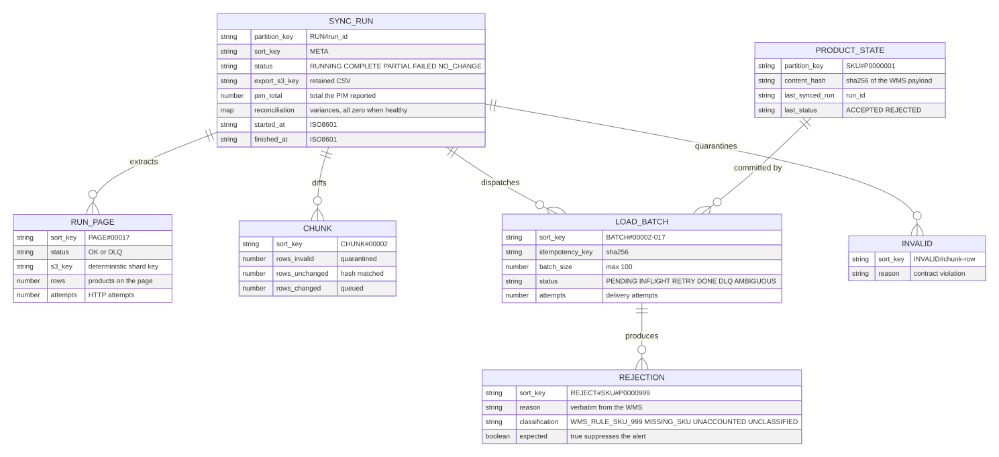

# Product Catalogue Integration — PIM → WMS

This repository runs the daily synchronisation of the product catalogue from the
PIM into the WMS. It is rebuilt as a **serverless, event-driven pipeline on AWS**
(the recommended design in the architecture document): Step Functions, Lambda, S3, SQS and
DynamoDB, with Terraform for the infrastructure. It is runnable and testable
locally against the supplied mocks and LocalStack.

- **[ARCHITECTURE.md](ARCHITECTURE.md):** design, execution, data and failure
  flows, rate limiting, "never sent twice", AWS choices, security,
  observability, assumptions and trade-offs.
- **[UNFINISHED.md](UNFINISHED.md):** what is not done, why, and what it would
  take.
- **[mermaid.md](mermaid.md):** source for every diagram below.

## Architecture


### Before and after




### Meeting the 30-minute window


### Request classification and retries


### Load phase, partial failure and "never sent twice"


### Dead-letter queue and replay


### State model



### Infrastructure and local harness


### Why serverless


## Running locally

Prerequisites:
- Docker Desktop.
- Python 3.11+.
- No local Terraform and no AWS account: both run in containers.

### 1. Install

```bash
python -m venv .venv
# Windows: .venv\Scripts\activate
# Linux/macOS: source .venv/bin/activate
pip install -r requirements.txt
```

### 2. Start the mocks and LocalStack, then apply Terraform

```bash
docker compose -f docker-compose.yml -f docker-compose.localstack.yml up -d --build
docker compose -f docker-compose.yml -f docker-compose.localstack.yml run --rm terraform
```

The second command applies `terraform/envs/local` to LocalStack. It creates:
- The KMS key and the Secrets Manager secrets, seeded with the mock API keys.
- The raw, exports and curated buckets, including the 90-day lifecycle on
  exports.
- The DynamoDB tables.
- The SQS queue and its DLQ.
- SNS and the CloudWatch alarms.

`docker-compose.yml` and `mock-services/` are unchanged.

*(Git Bash on Windows: prefix docker commands with `MSYS_NO_PATHCONV=1`.)*

### 3. Run the pipeline

```bash
python -m app.main run                 # a run: prints status, counts and reconciliation
python -m app.main run                 # again: NO_CHANGE, nothing sent to the WMS
python -m app.main status              # recent runs and the run lock
python -m app.main status <run_id>     # one run's ledger and reconciliation
python -m app.main resume <run_id>     # continue an interrupted run from its checkpoints
python -m app.main replay-dlq <run_id> # re-send only dead-lettered batches, same idempotency keys
```

`run` executes the same stage functions as the Lambdas, in the state machine's
order. It uses worker threads for the Distributed Map and the real LocalStack
SQS queue for the load phase.

### 4. Optional: run the real state machine and Lambdas inside LocalStack

```bash
python scripts/build_lambda.py --arch x86_64
docker compose -f docker-compose.yml -f docker-compose.localstack.yml run --rm terraform \
  "terraform apply -auto-approve -var localstack_endpoint=http://localstack:4566 -var enable_compute=true"
python -m app.main start-execution
```

## Tests

```bash
pytest              # 67 tests: unit, chaos, rate conformance, moto-backed pipeline tests (~3 min)
pytest -m e2e       # 8 end-to-end tests against the running docker stack (step 2 first)
```

The pipeline tests run the **unmodified** mock services in-process. A forwarding
client injects persistent 5xx and timeouts, so dead-letter, replay, ambiguous
and resume behaviour is exercised without changing the mocks.

## Repository layout

```
app/                    application code (all Python changes live here)
  clients/              PIM and WMS clients
  resilience/           rate budget, backoff + jitter, circuit breaker, classified HTTP
  domain/               data contract, mapping.json, hashing, batching, rejection rules
  state/ledger.py       DynamoDB run ledger, batch state, product hashes, run lock
  storage/s3.py         S3 zones and streamed CSV export
  pipeline/             stages: start_run, extract, assemble, diff, load, finalize, replay
  handlers/             thin Lambda entry points
  stepfunctions/        state machine definition (ASL)
  local_orchestrator.py local stand-in for the state machine
  main.py               operator CLI
terraform/modules/      security, storage, state, load, extract, orchestration, observability
terraform/envs/         local (LocalStack), dev, prod
tests/                  unit, chaos, rate conformance, pipeline; tests/e2e against docker
scripts/                build_lambda.py, render_diagrams.py
docs/diagrams/          rendered SVGs (from mermaid.md)
docker-compose.localstack.yml   LocalStack + Terraform runner
```

To regenerate the diagrams after editing `mermaid.md`, run
`python scripts/render_diagrams.py` (it uses the `minlag/mermaid-cli` Docker
image).
