# Diagram sources (Mermaid)

Source for every diagram in `README.md` and `ARCHITECTURE.md`. The figures follow the
architecture document's Appendix B and have been updated to show what was **built**.
Items marked *(future, Uₙ)* are listed in `UNFINISHED.md`.

Render to `docs/diagrams/*.svg` with:

```bash
python scripts/render_diagrams.py      # uses the minlag/mermaid-cli Docker image
```

Each block is preceded by a `<!-- file: name -->` marker that names its SVG.

## 1. Current implementation (before)

<!-- file: 01-current-implementation -->
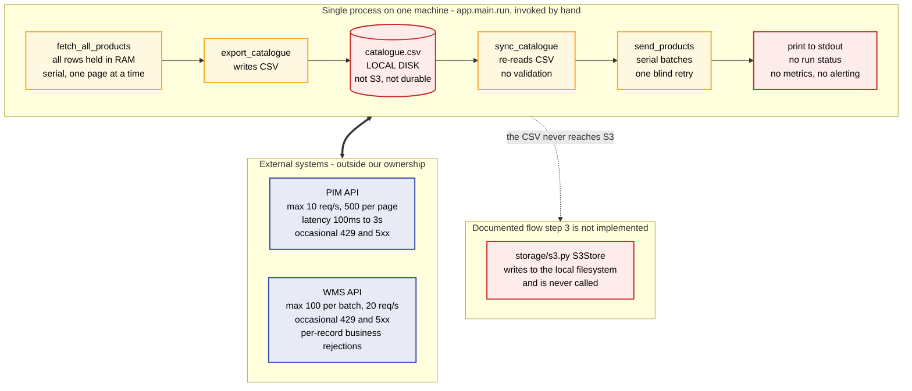

## 2. Throughput arithmetic and the 30-minute window

<!-- file: 02-throughput -->
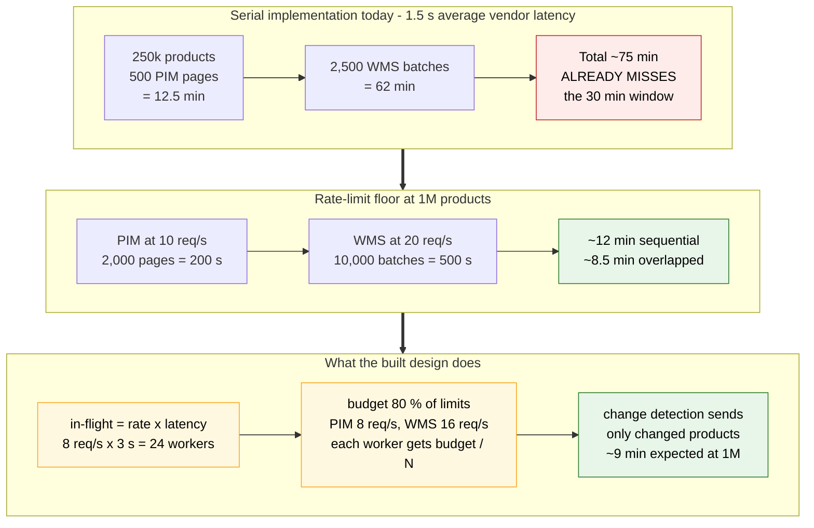

## 3. Option 1 architecture (as built)

<!-- file: 03-architecture -->
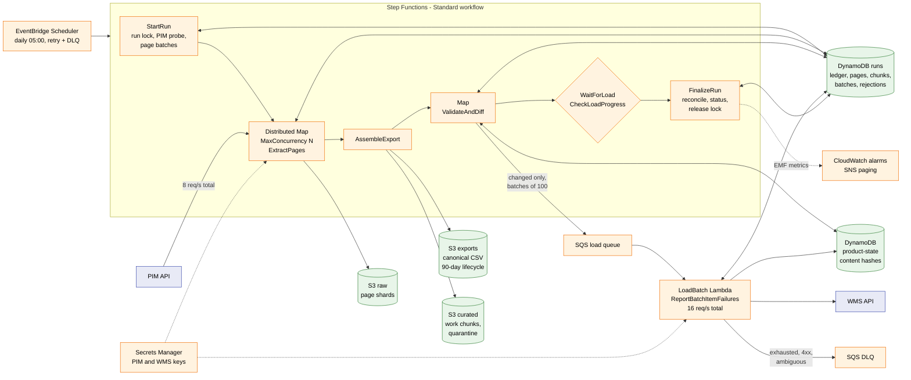

## 4. Never sent twice: readings and decision

<!-- file: 04-never-sent-twice -->
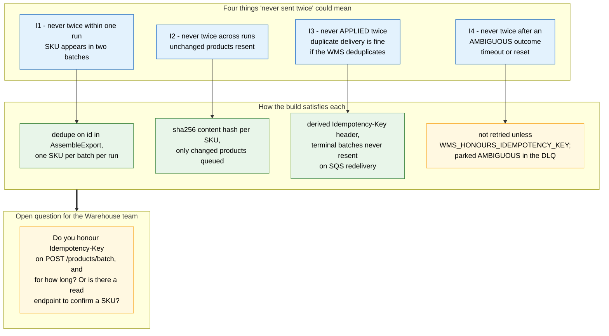

## 5. Request path and outcome classification

<!-- file: 05-request-classification -->
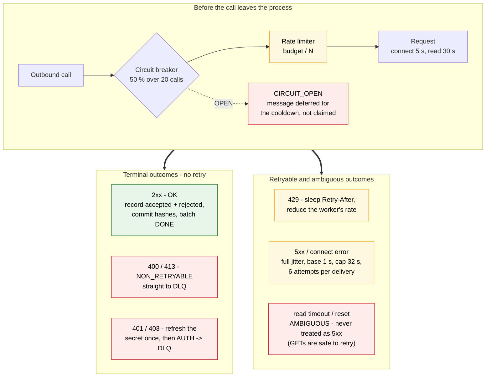

## 6. Load phase and per-outcome handling

<!-- file: 06-load-phase -->
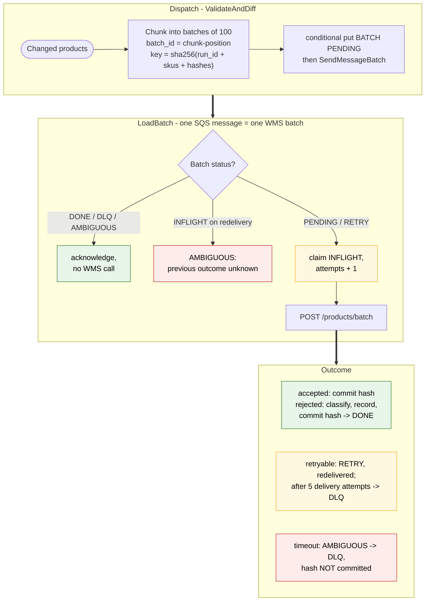

## 7. Dead-letter handling and replay

<!-- file: 07-dlq-replay -->
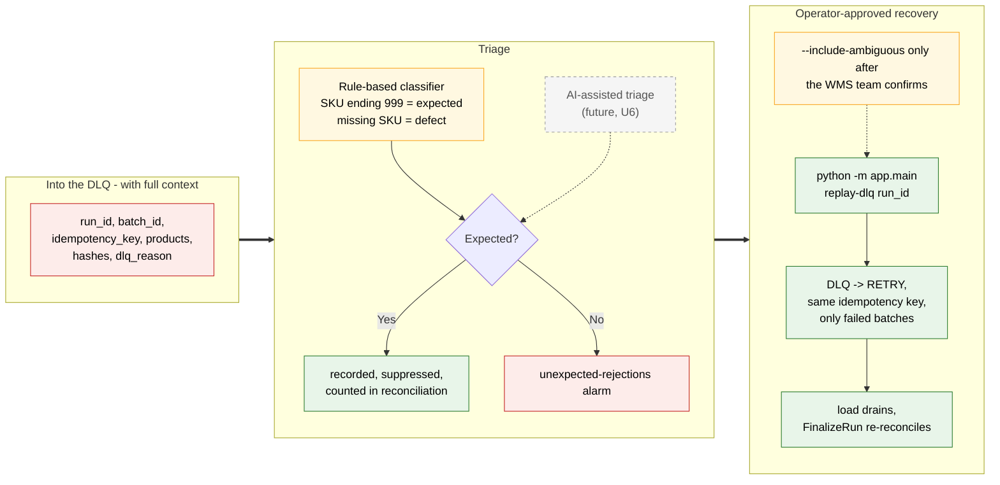

## 8. State model

<!-- file: 08-state-model -->
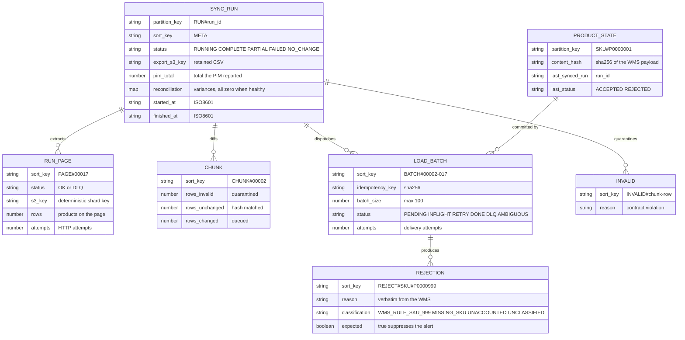

## 9. Terraform layout

<!-- file: 09-terraform -->
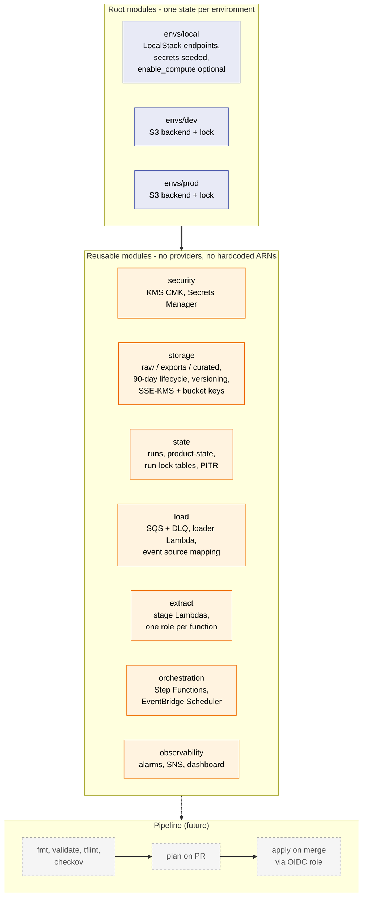

## 10. Local development and test harness

<!-- file: 10-local-harness -->
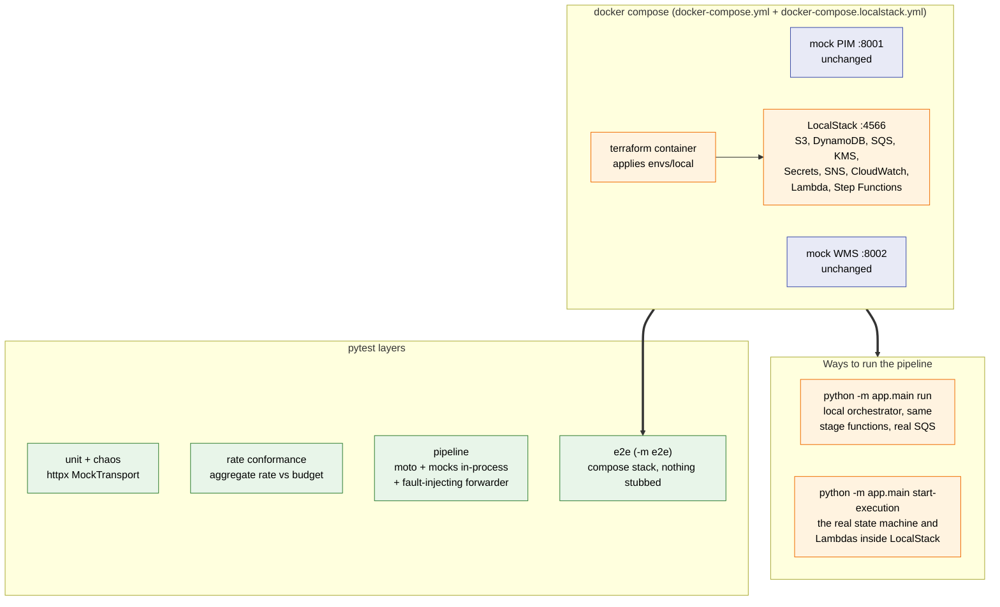

## 11. Current to target mapping

<!-- file: 11-current-to-target -->
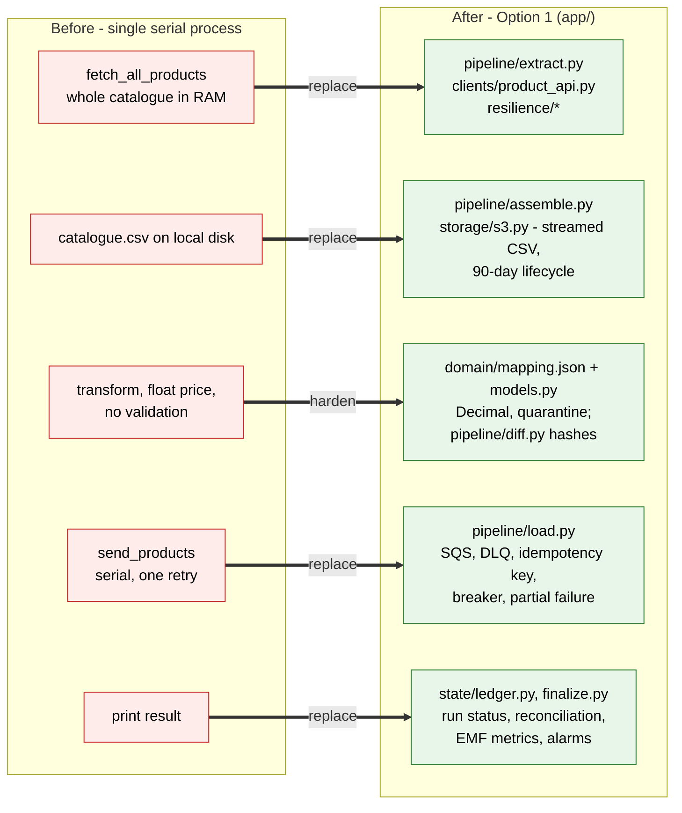

## 12. Platform decision path

<!-- file: 12-decision-path -->
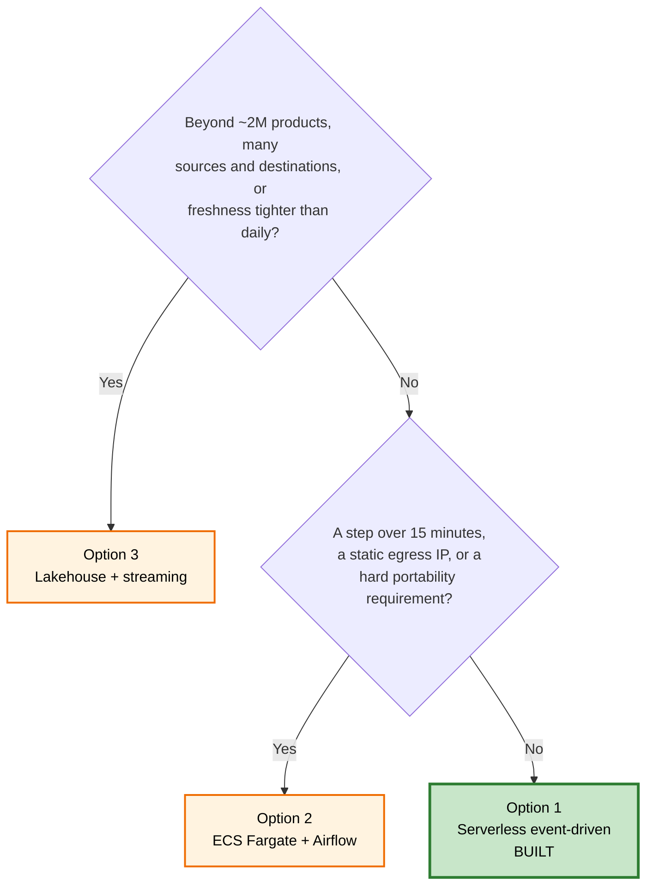
